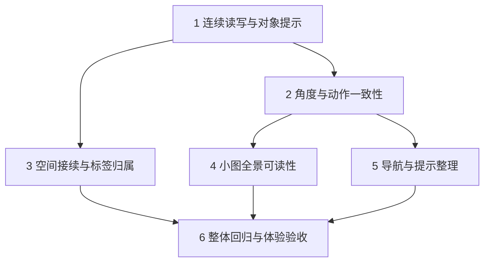

# 报告复核与修改计划

## 判断

报告抓住了真正的主问题：**阅读进入写作时上下文消失，正文空间被辅助内容挤占，操作作用于谁、采用什么角度没有充分表达。** 这三件事应作为一条连续体验修复。

但不能把报告里的所有原因和方案直接转成任务。它把部分既有设计当成了缺陷，也遗漏了现有动画、深度避让和草稿恢复机制。推荐保留液态舞台、低饱和软边、独立文字和正／反／合的结构，修复交互与反馈之间的不一致。

本方案已由用户以“你开始执行，记得 commit push，腾讯服务器公网同步”批准实施、提交、推送与现有公网部署。主线程沿用现有 `main` 工作空间执行；原报告保持原样。下列裁决保留计划阶段的证据边界，执行进度见勾选项及独立验收记录。

## 证据与约束

- 原始报告：[Claude 审阅](../reviews/2026-10-29-reading-flow/claude-review.md)，保存原文的可提交副本。计划阶段还对照了原输出目录的 `review.md`、`evidence/capture-notes.md`、`evidence/reading-geometry.json`，并直接查看 04、11、15 三张截图。
- 本轮补读了生成提交、阅读／输入、角度继承、全景聚合、三维投影、深度避让、标签布局和动画接续源码，以及相关测试断言。测试文件是意图证据，不能视为本轮测试已通过。
- 既有约束来自 `docs/flow-continuity-2026-10-23.md`、`docs/reviews/2026-10-28-surface-controls/plan.md`、`docs/reviews/2026-10-28-lama-emil-frontend/fix-plan.md`、`docs/reviews/2026-10-28-app-experience-postfix/fix-plan.md` 和 README。历史文档中的提交／部署授权不扩展到本次任务。
- 阅读与草稿目标分离、引用来源保护、工作区恢复、请求归属、重试快照、用户注意力保护均保留。阅读顶部的正反／极性／组合三个主操作继续同级可达。
- 保留桌面双击推演、触屏长按拖动、静态融合范围、内容坐标、已保存位置、渲染后端选择与回退。本方案不更换渲染器、生成模型或服务端协议。
- 没有新的受控浏览器实验；真实软键盘、触控、开关阅读的同焦点位移仍需实施时验证。证据足以制定方案，不足以宣称这些场景已经通过。

## 逐项裁决

| 原编号 | 我的判断 | 采纳范围与纠正 |
|---|---|---|
| D1 点输入框收起原文 | **成立，P1** | 点击输入导致退出有实测，外部点击处理可解释。普通写作与阅读应共存；“继续写”只显式更换对象并聚焦。还要处理输入焦点、Escape、异步结果和阅读锚点，不能只补一个点击豁免。 |
| D2 落位变化、静态融合 | **部分成立，P2** | “会在这里落位”过度承诺，部分标签归属不清。截图不能证明缺少连续动画；现有代码已有占位接续和三维深度避让。禁止静态融合、统一拉开一个直径、禁用内容坐标均不采纳。普通输入生成未接上明确的正反占位映射，是更具体的修复点。 |
| D3 下一次生成的角度 | **文案与入口不一致成立，P2；默认规则建议不采纳** | 原角度继承有现有测试支持。保留继承规则，统一入口提示和显式切换；普通输入生成的正反也应保存实际请求框架。组合／新写作与对现有种子的直接展开可有不同规则，但必须说清。 |
| D4 四节点全景聚合 | **成立，P2** | 本例小图默认跨代聚合妨碍回看来路，进入动作也太靠后。“任何手机三代图都如此”过度泛化。不直接采用任意的 30 节点阈值，也不重做纵向全景。 |
| U1 正文空间太小 | **成立，P1** | 320×640 的约 64px 正文有几何证据。压缩前置说明并测量实际输入占用；保留顶部同级主操作，不照搬全部移到文末的建议。原报告行数指标是提案，不是已有验收约定。 |
| U2 命名漂移 | **部分成立，P2** | 同一操作名称应统一，“继续展开”仅打开阅读确实不准确。“合／组合／新的联系”分别可能是结果、动作和理解变化标签，不应全改为一个词。“想法只指用户节点”不采纳。 |
| U3 两个当前对象 | **提示问题成立，P2；状态分离正确** | 窄屏隐藏操作对象、根目标隐藏成立。未实测错目标提交；成功后重置目标还受注意力条件控制，并非无条件清空。应显示真实目标，不能把浏览行为改成偷偷重定向草稿。 |
| U4 更多菜单 | **部分成立，P3** | 最近工作区位于附加设置之后属实。菜单顶部其实已有当前工作区名称；没有证据要求永久占用主导航。前移最近工作区、解释画作入口即可，保留手动渲染选择。 |
| U5 阅读使舞台跳位 | **机制可疑，缺少受控验证** | CSS 确会因主操作行消失而改变舞台可用区；两张截图焦点与时点不同，不能证明报告所称的 30–60px。列入固定焦点的布局验证，复现后修复，不作为已测量缺陷。 |
| U6 单击等待／双击生成 | **行为存在，属于既有取舍** | 260ms 是桌面指针区分双击的等待；触屏点击与键盘激活不走同一等待。移除双击和要求所有单击小于 100ms 不采纳。补充可发现的操作说明，保留既有反馈。 |
| U7 引导重复／等待不能写 | **引导重复成立；不能编辑的结论不成立** | textarea 未禁用，等待时可改写，只是已提交文字仍占据输入框。更关键的是普通输入成功后才提交图，等待时的“根”只是占位。不能据此立即清空输入；保留草稿与版本保护，只去重提示。 |

### 影响方案的补充证据

1. **融合与合成是不同层次。** README 明确保留其他种子静止时的融合范围；`src/components/dialogue/liquid/depth.ts` 会沿视线分开体积而保持屏幕锚点。`DialogueMetaballLayer.tsx` 还经过投影、自动取景与缩放。仅用 CSS 直径和百分比间距无法推定最终相交原因。应明确表达可交互的组合候选，而非禁止所有视觉邻近。
2. **接续动画已经存在，但普通输入的映射不完整。** `BubbleStage.tsx` 用 `arrivals.firstId/secondId` 对应 `pending-thesis/antithesis`，`liquid/motion.ts` 继承占位的体积、深度和速度；`liquid/motion.test.ts` 已有相关断言。`DialogueShell.handleSubmit` 只在直接推演时构造 `nextExpansion`，普通输入分支没有提供同样的结果映射，可能落到来源或最近物体的通用出生逻辑。静态截图不足以证明动画断裂，但这条入口差异可以直接修正并验证。
3. **继承不是偶然行为。** `SeedInspector.test.tsx` 明确断言“沿用端点框架，直到用户主动选择当前角度”。`commitSeedSplitResult` 传入 frame，`commitBranchesResult` 没有，造成同类正反节点的记录不一致。模型对正文的内容评分也不等于用户当时选择的生成角度，不能互相冒充。
4. **提前清空可能破坏恢复。** `commitBranchesResult` 在响应合法性验证后才创建用户节点；重试快照在内存 ref 中。当前 journal 保存的是输入框草稿，直接清空会让未成功的首次输入失去现有的刷新恢复路径。这是从生命周期推导出的风险，本轮未制造丢失实验。

## 拟采用的体验与接口约定

### 阅读与写作

| 操作 | 阅读行为 | 写作目标与焦点 |
|---|---|---|
| 点击／Tab 进入普通输入框 | 保持正文和读位，可继续滚读 | 不重新计算目标；有草稿时保留原来源 |
| 点阅读内“继续写” | 保持阅读 | 显式指向该种子、清理被替换的引用／暂存模式，保留现有文字处理规则并聚焦输入 |
| 点“写新想法” | 保留当前阅读作为参考 | 显式切到独立新想法；不把它视为退出阅读 |
| 返回舞台／点空白舞台 | 关闭阅读 | 草稿不动，主动退出计入注意力版本 |
| Escape | 先关闭菜单、极性选择、引用选择等最内层状态 | 在普通 textarea 中先失焦、保留阅读；随后从阅读层 Escape 返回舞台。中文输入法组合期间不拦截取消键 |
| 全景退出 | 恢复原正文、选句与读位 | 恢复到全景入口；进入指定种子仍不覆盖已有草稿目标 |
| 等待期间继续读或写 | 原文、输入焦点保持 | 合法结果保存；用户有新的阅读／编辑意图时不抢回焦点、不覆盖草稿 |

阅读布局采用：固定的轻量返回／选句工具行 → 标题 → 紧凑理解变化 → 同级主操作 → 正文。详细理解变化可展开；“与此前相近”的状态和证据入口继续可见。键盘挤压时优先保留正在读的文字锚点，让标题和主操作随正文滚动，不缩小正文字号。

### 角度与操作语言

| 场景 | 默认采用的框架 | 可见说明／覆盖规则 |
|---|---|---|
| 新想法、补充文字后生成正反 | 当前工作区角度 | 输入区显示本次生成角度 |
| 现有种子直接推演／沿极性展开 | 种子保存的 frame；旧数据缺失时回退当前角度 | 与当前角度不同才增加提示和“改用当前角度”入口；舞台、阅读、双击共用解析 |
| 用户显式切到当前角度 | 当前工作区角度 | 同一活动种子的舞台与阅读保持一致；切种子或工作区后恢复默认 |
| 组合 | 当前工作区角度 | 生成前显示本次角度；不宣称继承某一个来源 |
| 引用追问、重试 | 继续沿用已有来源／请求快照规则 | 重试不因之后修改工作区角度而改变原请求 |

拟统一三个同级动作名为 **“推演正反／沿极性展开／组合”**；极性说明明确“一条维度的两个端点”，不把端点等同于正反。结果仍叫正、反、合；“新的联系”等理解变化标签保留。相机操作叫“观察方向”，生成设置叫“思考角度”。只打开结果正文的按钮叫“阅读合”。普通叙述继续可以使用“想法”。

新生成的正反保存实际请求 frame，复用现有 `fissionFrame` 元数据，不新增服务端协议。旧工作区不回填猜测的 frame，不用内容评分推断历史选择。

## 实施单元与顺序

以下任务已获实施授权。依赖图表示技术先后；未派发 agent 或建立新的分支、工作空间。

### 1. 连续读写、正文空间与对象提示 · P1

- [x] 完成 D1、U1、U3 的联动修复。普通输入保留阅读，目标独立显示，选句入口移至工具行，理解变化折叠，焦点及 IME Escape 保护已实现。

**模块／接口：** 修改 `src/components/dialogue/DialogueShell.tsx`、`src/components/dialogue/SeedReadingContent.tsx`、`src/components/dialogue/DialogueComposer.tsx`、`src/components/dialogue/SeedInspector.tsx`、`src/components/dialogue/SeedPassage.tsx`、`src/components/dialogue/SeedMeaning.tsx`、`src/components/dialogue/DialogueShell.module.css`、`src/components/dialogue/SeedMeaning.module.css`。维持 `DialogueShell` 的状态归属；扩展阅读保持区域，覆盖整个普通 composer；显式更换目标与关闭阅读拆开。`SeedPassage` 提供可从阅读工具行触发的选句入口，继续回传选择状态。

**实施决定：**

- 输入对象行进入正常布局，使现有 ResizeObserver 测到对象、引用、输入、等待与错误的全部占用。阅读下边界采用实际占用和统一间距，替代叠加的 52／96px 常量；复用现有可视视口观察，不建立逐帧 DOM 测量。
- 普通有内容工作区始终显示“基于「…」”或“独立的新想法”；首次空白工作区不必再重复解释。窄屏舞台保留“对「…」”的截断名称与完整可访问名称；需要换行时自然布局，不靠绝对定位挤在同一行。
- 阅读内以标题表达操作对象，输入区表达草稿对象。两者不同属于正常状态，不做警报，也不自动重定向。等待时明确“本次生成”与可继续编辑的草稿，复用已有请求快照。
- 理解变化在空间紧张时折叠成一行入口，全文和依据可展开；保留未核对／相近结果的准确表达。三项主操作仍在正文前同级，移除独立占一行的选句入口。
- 遵守上面的 Escape 层级；聚焦输入本身计入用户注意力，避免新结果在用户尚未输入字符时收起原文或抢焦点。

**测试路径：** `src/components/dialogue/SeedReadingContent.test.tsx`、`src/components/dialogue/DialogueShell.test.tsx`、`src/components/dialogue/DialogueComposer.test.tsx`、`src/components/dialogue/SeedInspector.test.tsx`、`src/components/dialogue/SeedPassage.test.tsx`；视觉场景放入 `scripts/visual-smoke/reading-continuity.mjs` 与 `scripts/visual-smoke/surface-controls.mjs`，视口边界复用 `src/features/dialectic/platform.test.ts`。

**关键场景：** 读 A＋草稿属于 B，点击输入与继续编辑后仍属于 B；无草稿时遵守现有选种子绑定；“继续写”明确改到 A、“写新想法”明确改到根；引用／暂存联系不因普通浏览丢失；菜单和极性 Escape 只退一层；输入法取消不退出阅读；全景往返保留读位；等待后只聚焦输入、继续滚读、修改草稿、主动退出、取消和迟到响应分别验证。

**拟验收：** 320×640、原三行草稿样本，首屏正文至少 6 个完整行高；390×844、1280×720 至少 8 行，正文维持当前 16px。上述数值是本方案建议的验收值。主要控件保留 44px 命中高度；真实键盘下原文可见且能滚动，输入和返回可达，不承诺所有设备固定保留三行。打开／折叠理解变化不丢阅读锚点；没有横向溢出、遮挡或输入失焦。

### 2. 统一角度解析与动作语义 · P2

- [x] 完成 D3 与 U2。共用角度解析器，普通正反记录请求 frame，舞台／阅读共用显式切换；统一三个主操作名称。

**模块／接口：** 在 `src/features/perspectives/seedExpansionFrame.ts` 新增小型纯解析器，输入来源种子、工作区框架、显式选择，返回有效框架、来源类型、差异提示；Shell 持有活动种子的临时选择，阅读与舞台共用。修改 `src/components/dialogue/DialogueShell.tsx`、`src/components/dialogue/SeedInspector.tsx`、`src/components/dialogue/PerspectivePanel.tsx`、`src/components/dialogue/SeedPrimaryActions.tsx`，并更新 `src/components/dialogue/SeedGuide.tsx`、`src/components/dialogue/BubbleStage.tsx`、`src/components/dialogue/EvolutionOverview.tsx` 中的相关操作文案。输入区角度说明从实际操作框架派生，引用追问也核对显示与请求一致，不无条件显示全局选择。

**生成记录：** `src/features/dialectic/controller.ts` 的普通正反提交接收实际请求 frame，传给已有 `BranchGraphStore.createAssistantPair`。请求发起后冻结 frame；取消、重试和跨工作区校验仍由原机制负责。普通输入的下一次直接推演因此与直接裂变结果遵守同一继承规则，这是本方案明确提出的行为修正。

**文案：** 面板说明当前选择用于新写作与组合，已有种子继续推演会保留原角度并可切换；不要继续承诺“下一次任何生成”。三个主动作使用统一名称；诗性叙述、理解变化类型和数据字段不做全局机械替换。

**测试路径：** 新增 `src/features/perspectives/seedExpansionFrame.test.ts`；扩展 `src/features/dialectic/controller.test.ts`、`src/components/dialogue/SeedInspector.test.tsx`、`src/components/dialogue/DialogueShell.test.tsx`、`src/components/dialogue/PerspectivePanel.test.tsx`，复用 `src/store/branchGraph.test.ts` 中已有元数据持久化覆盖。

**关键场景／验收：** 普通输入正反、直接推演正反、极性端点分别改全局角度后继续推演：有快照默认继承，显式切换后用当前值；舞台、阅读、双击对同一选择发出的 frame 一致。旧无快照节点回退当前值且不改历史图；组合和普通输入遵守矩阵；等待时改角度不影响已发请求，重试仍用原快照。界面提示与实际请求一致，不能只测文案。

### 3. 补齐生成接续、明确标签归属 · P2

- [x] 修复 D2 的可证实部分，并核验 U5。请求结果接续同角色占位，标签带归属和必要引线；受控实验复现并修复阅读开关改变逻辑视口的问题。

**模块／接口：** 修改 `src/components/dialogue/DialogueShell.tsx`、`src/components/dialogue/BubbleStage.tsx`、`src/components/dialogue/labelLayout.ts`、`src/components/dialogue/DialogueMetaballLayer.tsx`、`src/components/dialogue/DialogueShell.module.css`。新增仅在 UI 生命周期内存在的“请求—结果—占位角色”映射，普通生成、直接展开、极性、组合共享已有 `data-liquid-origins` 接续通道；不要为了动画而把普通输入伪装成展开结果提示，也不把渲染映射写入 graph。

**实施决定：**

- 普通输入提交得到 user／正／反 ID 后，分别关联已有根占位（若存在）和同角色正反占位。映射校验 workspace session 与请求归属，取消、失败、切工作区后清理；没有该请求预览时按真实来源出现，不能接到其他请求的占位。不为动画抢焦点、改变场景预算或挤走正在阅读的对象；不可见结果以后出现时按真实来源展示。
- 复用 `liquid/motion.ts` 的体积、深度和速度接续；保留最终语义坐标与已保存位置。将等待文案改为“正在深化主张、质疑前提”，不承诺未知的最终位置。
- 标签布局给 surface 增加归属 ID，评分兼顾自身锚点与避让。不得只追求文字不重叠而把标签推到别人的液滴旁。极端拥挤无法就近摆放时，用细引线指回自身；点选／键盘焦点同步强调对应液滴。引线及标签使用共同的投影结果，不新增逐帧测量。
- 保留静态软融合。只有有效拖动候选显示组合状态；“松手合成”与普通邻近清楚区分。不改业务合成阈值。
- U5 在相同种子、相同相机／缩放、相同草稿与动画稳定后比较：若阅读开关仍改变舞台几何，移除仅因操作行显隐而改变逻辑视口的依赖；标签避让继续按真实遮挡计算。单元 1 已消除的问题不重复改。记录复现或未复现结论。

**测试路径：** `src/components/dialogue/BubbleStage.test.tsx`、`src/components/dialogue/DialogueShell.test.tsx`、`src/components/dialogue/labelLayout.test.ts`、`src/components/dialogue/liquid/motion.test.ts`、`src/components/dialogue/liquid/depth.test.ts`；视觉接续和候选验证扩展 `scripts/visual-smoke/thought-flow.mjs`、`scripts/visual-smoke/liquid-surface.mjs`。

**关键场景／验收：** 相同方向的正反结果仍分别接续各自预览；覆盖初次生成、已有图中新写作、续写、直接推演、极性、组合、取消后新请求、减少动态、旧节点重叠与视角旋转。既有位置不被重排，真实节点与标签点击归属一致；需要远移的标签有清晰指向。开关阅读的稳定几何差异以 4px 作为建议回归容差，固定镜头并排除环境形变。两种渲染后端及回退共享同一归属，不新增空闲逐帧布局读取。

### 4. 小图全景优先展示真实来路 · P2

- [x] 完成 D4。小图独立展示，仅聚合同代冲突节点，保护活动来源；主要详情动作前置并保持 44px 高度。

**模块／接口：** 修改 `src/components/dialogue/EvolutionOverview.tsx`、`src/components/dialogue/EvolutionOverview.module.css`；将可视分组策略提取到 `src/components/dialogue/evolutionClustering.ts`，只返回显示组和节点映射，不改图关系或代际计算。

**实施决定：** 不因缩放低于 .78 就合并少量节点。以主舞台现有的 8 节点可见预算作为小图保护边界：不超过 8 个节点保留独立节点、名称和类型，不要求把所有标题同时塞进一屏；更大图只在显示密度需要时聚合，分组包含 generation，不跨代。活动节点、直接来源和当前回放节点保持可辨识。超过 120 节点保留已有紧凑布局与成员列表。默认视图与“适应全景”共用规则；继续保留横向代际、平移和缩放。拟将“显示密度需要”落实为投影后的标签／命中区实际冲突：只有同代且相互冲突的非保护节点可以成簇；正常分组与可见名称使用相同的屏幕几何，不再仅依赖缩放阈值。

节点详情先放标题与“进入种子／回放来路”，随后显示理解变化、摘要、来源；长摘要在一个详情滚动区中阅读，避免摘要内再套滚动。当前返回行为继续保留原阅读与草稿。

**测试路径：** 新增 `src/components/dialogue/evolutionClustering.test.ts`；扩展 `src/components/dialogue/EvolutionOverview.test.tsx` 和 `scripts/visual-smoke/thought-flow.mjs`，复用 `src/features/dialectic/evolution.test.ts` 的来路与双来源断言。

**关键场景／验收：** 原 390×844 四节点三代样本，四个节点及正反合／起点可辨，双来源边不因聚合被吞；进入动作不滚动即可达。覆盖 8／9、120／121 边界、同代密集、多代细链、搜索筛选、缩放后点击簇、回放与返回。受限宽度允许横向平移，不通过跨代合并来适应屏幕。

### 5. 导航与引导减负 · P3

- [x] 处理 U4、U6 的可发现性、U7 的重复说明。最近工作区前移并折叠其余项目，画作入口有用途说明，引导去重，等待明确可编辑。

**文件：** `src/components/dialogue/WorkspaceBar.tsx`、`src/components/dialogue/DialogueShell.tsx`、`src/components/dialogue/SeedGuide.tsx`、`src/components/dialogue/BubbleStage.tsx`、`src/components/dialogue/DialogueShell.module.css`；行为验证使用 `src/components/dialogue/WorkspaceBar.test.tsx`、`src/components/dialogue/SeedGuide.test.tsx`，布局复用 `scripts/visual-smoke/app-experience.mjs`。

**实施决定：** 菜单已有的工作区名称保留，最近工作区移到工作区区域并置于附加功能之前；默认展示最近两项，其余可展开。新建、改名、导入导出继续可达。画作入口说明其作用于当前草稿及结果形式；渲染选择、外观与实验入口保留在后面的设置区域，不增加导航常驻文字。

空态保留中央主引导与简短输入占位，取消额外重复说明；舞台常驻手势提示只保留一处。桌面双击推演放入可重新打开的操作提示，触屏说明长按拖动。保留 260ms 双击判定，不擅改手势。等待时仍保留可编辑草稿，状态行解释可编辑，避免只依靠被原文字挡住的 placeholder。

**验收：** 320×640、至少两个历史工作区时，菜单首屏可见当前名称与最近两项；菜单 Escape、改名归属和切工作区恢复不退化。等待时能修改输入，成功／失败／取消／刷新后保持既有草稿保护。不为纯文案重写创建镜像测试，只覆盖展开、焦点等实际行为及关键视觉结果。

### 6. 完整回路与交付验证

- [ ] 合并前面所有单元后验证整条产品回路，结果保存为本次独立证据，不覆写原报告。

**顺序：** 单元相关组件与纯函数测试 → 类型与 lint → 全量已有回归与生产构建 → 必需的浏览器视觉验证。复用既有脚本及预算，不增加测试总时限来掩盖问题。本轮计划阶段未执行这些检查。

**主回路：** 首次写作 → 等待时编辑 → 正反出现 → 打开阅读 → 边读边写 → 显式更换对象 → 选句追问 → 沿极性展开／推演正反 → 组合 → 阅读合 → 全景回看来路 → 返回 → 刷新及切换工作区恢复。

**覆盖：** 1280×720、390×844、320×640，加已有平板与短横屏边界；浅／深色、键盘导航、中文输入法、减少动态、原版／TSL／回退；失败重试、取消迟到结果、等待中主动退出和继续阅读。组件测试不能代替正文空间、实际标签归属和动画接续的浏览器观察。

**真机门槛：** 软键盘弹出／收起、真实长按拖动、多点手势与安全区需实体手机验证。若只有模拟器或视口模拟，明确列为未验证，不能声称“移动 app 体验验收完成”。

## 风险、非采纳项与完成边界

- 阅读和输入共存后，最大风险是焦点、注意力版本和请求自动接管互相冲突；单元 1 必须先验证异步状态，再做后续装饰性调整。
- 输入对象行纳入实际高度会影响舞台与阅读边界，所以空间接续的基线在单元 1 后采集，避免在会变化的布局上调参。
- 补齐 frame 会使**新生成的普通正反**开始默认沿用其创建角度；提示和覆盖入口要与记录同时交付。旧数据保持兼容，不进行未经证实的迁移。
- 不采用：禁止静态融合、停用内容坐标、移除双击、提交即清空草稿、把所有“想法”限制为用户节点、把三项主操作全部移到文末、直接重做纵向全景。
- U5 已在固定焦点实验中复现：阅读开关使逻辑舞台高度由 415px 变为 523px，节点位移约 20–86px。修复后高度保持 415px，候选生产构建三尺寸的最大位移小于 0.002px。真实设备上的动画感受仍需实体手机验证。
- 修改范围是上述体验链，不扩展到模型质量、圆桌架构、数据迁移或新的导航系统。没有新增 agent、分支、worktree。用户的后续明确指令批准了 commit、push 和腾讯服务器现有公网入口同步。
- 单元 1–5 已实施，单元 6 在执行。实体手机软键盘、多指及安全区不在视口模拟验收的结论内；后续记录明确列为未验证。

## 计划自检

已在主线程检查需求追溯、入口一致性、状态恢复、实施依赖和测试路径。每条原报告意见均有裁决，采纳项映射到具体单元；不采纳与证据不足项单列，没有把旧测试描述成新验证，没有把历史授权继承为本次部署授权。
