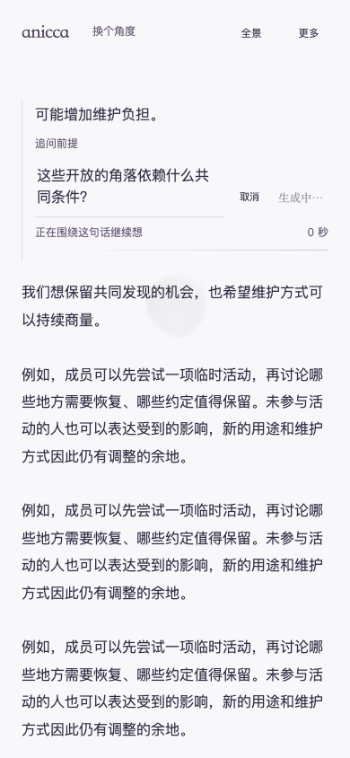
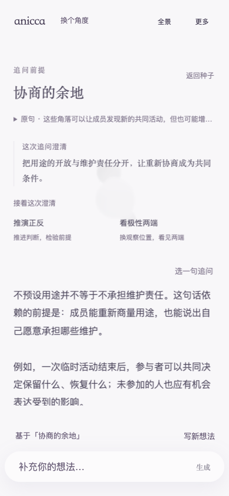
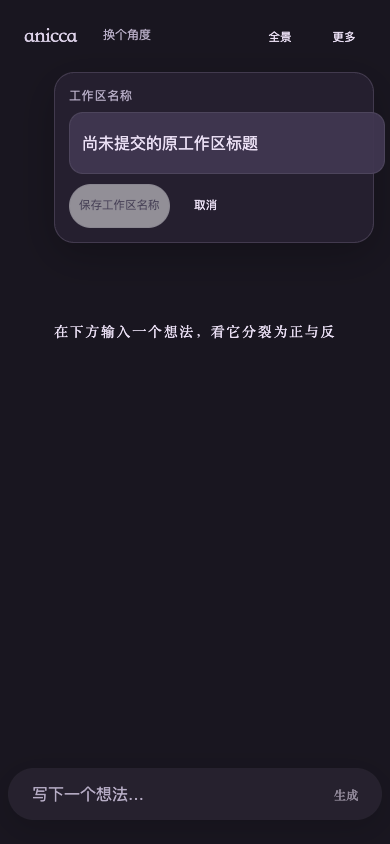
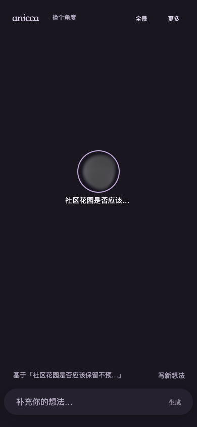

# Anicca：55a99f9 上线后的独立 App 体验复审

> 后续实施状态：本轮 2 项 P2、1 项 P3 已修复并发布，双域名桌面/移动验收通过；具体结果与证据见 [修复验收记录](./fix-verification.md)。以下保留 55a99f9 审阅时的结论。

日期：2026-10-28。范围：当前网页前端的 app 般操作连续性、UI/UX、移动可达性和阅读沉浸。此次只读审阅，新增文档和审阅证据；没有修改源代码、提交、推送或部署。

## 结论

确认 **2 项新增 P2、1 项 P3**，没有发现新增 P1。无卡片阅读、低饱和软糯材质和按需展开的方向得以保留；主要问题集中在等待期间的注意力归属，以及跨工作区编辑的对象归属。

| 编号 | 级别 | 用户可见的问题 | 复核结果 |
| --- | --- | --- | --- |
| P2-01 | P2 | 提交追问后继续滚动原文，回应到达仍切换到新回应并抢走阅读焦点 | 桌面滚至 650、移动触摸模拟滑至 307 后，均跳到新回应顶部 0；不滚动和继续写草稿均有对照 |
| P2-02 | P2 | A 的未提交重命名表单带到新建的 B，保存时却修改 B 的名称 | 两端均复现；工作区 ID 已改变，旧表单仍打开；保存后 B 改名、A 保持原名 |
| P3-01 | P3 | 移动长文读到中段后，显式「返回种子」已随页头滚走 | 外侧轻点仍可退出、重开保持 650；属于入口可发现性问题，未判为无法退出 |

独立报告：[Lama](./lama-review.md)、[Emil](./emil-review.md)。两位评审分别读取对应 skill 和源码，未读取彼此报告或之前的主观评审；共享的是同版本客观截图、状态和复现记录。浏览器补查统一由主线程执行，两位评审独立判断证据。

## P2-01：等待回应时，继续阅读应撤销自动跟随

复现路径：打开长文 → 选一句 → 追问前提 → 提交 → 暂缓受控回应 → 用鼠标滚轮或触摸滑动继续读原文 → 放行回应。

- 桌面：原文 `scrollTop=650` → 「协商的余地」`scrollTop=0`，焦点转至新回应标题。
- 移动触摸模拟：原文 `scrollTop=307` → 同样切到新回应顶部及标题焦点。
- 无操作对照：回应自动打开，符合原有连续操作路径。
- 继续写草稿对照：原文、草稿、输入焦点保持，说明已有注意力保护只覆盖部分操作。

源码：[提交和返回判定](/Users/aitoshuu/Documents/GitHub/Anicca/src/components/dialogue/DialogueShell.tsx:1854)、[滚动仅记录位置](/Users/aitoshuu/Documents/GitHub/Anicca/src/components/dialogue/SeedInspector.tsx:148)。`attentionVersion` 的比较没有把用户继续阅读的滚动纳入其中。

修正方向：把明确的阅读滚动意图纳入当前请求的自动跟随条件；用户已经继续读时只保存并提示新回应，由用户选择进入。区分用户滚动和程序恢复位置，保留没有新操作时自动打开回应的路径。原文和新回应都未丢失，本问题是阅读被打断。

证据：[延迟与返回探测](./evidence/attention-return-probes.json)，其中 `desktop-pending-scroll` / `mobile-pending-scroll` 对比同端的 `idle` / `edit`。6 个回应均由测试路由提供，未调用真实模型，不能据此评价模型时延。

## P2-02：重命名会话需要绑定工作区

复现路径：在 A 打开重命名 → 输入「尚未提交的原工作区标题」但不保存 → 更多 → 新建 B → 原重命名表单仍显示该草稿 → 保存工作区名称。

两端都记录到：`workspaceId` 从 A 变为 B；B 初始标题为「未命名工作区」，旧表单仍存在；保存后 B 的名称变为该草稿，A 的名称没有改变。不会损坏正文，但用户发起的编辑对象在同一表单会话中发生了变化。

源码：[改名草稿只在非编辑时同步](/Users/aitoshuu/Documents/GitHub/Anicca/src/components/dialogue/WorkspaceBar.tsx:43)、[提交调用当前回调](/Users/aitoshuu/Documents/GitHub/Anicca/src/components/dialogue/WorkspaceBar.tsx:56)、[回调用当前工作区 ID](/Users/aitoshuu/Documents/GitHub/Anicca/src/components/dialogue/DialogueShell.tsx:1159)。

修正方向：工作区变化时关闭并重置改名会话，或为会话绑定工作区 ID 并阻止向另一工作区提交；不需要增加卡片或新的确认层。

证据：[改名与稳定暗色探测](./evidence/rename-dark-probes.json) 的 `rename-original-draft` → `rename-new-workspace-still-open` → `rename-save-after-switch` → `workspace-list-after-save`。

## 已排除的疑点与保留项

- 未再复现 681–980px 输入框屏外、更多菜单和极性 Escape 越级退出；同版本前轮回归已有完整证据。
- 阅读中从全景、换角度返回保持 650 和触发控件焦点。
- 没有主动关闭阅读时，新建工作区再切回原工作区，阅读自动恢复并保持 650。普通草稿切换和刷新也保留。
- 320px 与 844×390 更多菜单可滚动到下方工作区入口。
- 全景入场淡入和收起阅读时的标签过渡会令过早截图偏淡；重新静置 1100ms 后，全景相关层透明度均为 1，暗色舞台标签为 `rgb(252, 251, 255)`、祖先透明度均为 1，未把过渡截图作为稳定对比度缺陷。
- 桌面控制台有已有的 Three.js 多实例 warning；没有观察到关联的页面崩溃，未直接按 UI 缺陷计入。
- 浏览器返回策略、Enter 发送策略等既有取舍没有因个人偏好再列为必修问题。

## 对象、方法与验证边界

| 项目 | 本轮实际依据 |
| --- | --- |
| Git | `55a99f976807ecb2c7a72fb90a15e6b8395a4614` |
| 腾讯云当前版本 | `/opt/anicca/releases/20261028-app-experience`；build `G0tgHltanXgUhENX7R9J8`；服务 active/running、重启数 0 |
| 公网 | `https://aitoshuu.me/Anicca`、`https://tongye.me/Anicca`；本轮两端页面均 200、地址保持对应域名、HTML 匹配当前 build |
| 新增操作证据 | 14 个隔离上下文、90 个状态、76 张截图，全部探测执行结束；未捕获页面异常。这里的计数表示覆盖记录，不表示上述 UX 问题已经通过 |
| 受控回应 | 6 次 inquiry，覆盖两端无操作 / 继续滚动 / 继续写草稿；真实模型调用 0 次 |
| 视口 | 桌面 1440×900；移动触摸模拟 390×844；菜单补查 320×568、844×390；稳定浅色和深色画面 |
| 浏览器方法 | Browser plugin not available；使用已有项目 Playwright Chromium 做必要的实际渲染和触摸模拟验证；未安装工具、未读取真实用户存储 |
| 同版本既有验收 | [前轮验证记录](../2026-10-28-app-experience/fix-verification.md)：692 项测试、类型检查、lint、Linux 构建；两个域名桌面/移动的完整生成流程包含 24 次真实接口成功。该记录没有被冒称为本轮重新执行 |
| 当前 CI 快照 | [记录](./evidence/ci-latest.json)：质量检查和构建已成功，Production dialogue smoke 抓取时仍在运行；不宣称整条 CI 已绿 |

本轮没有重新接入 iPhone/Android 真机，没有验证系统软键盘、中文 IME、辅助技术或持续 GPU 性能。截图与操作轨迹能证明可见行为和内容连续性，不能证明真实用户的心理心流或思维启发效果。

证据索引：[evidence-index.json](./evidence/evidence-index.json)。可重放的临时探测源码已作为 `capture*.mjs.txt` 保存；只写隔离测试上下文，不修改产品代码。

## 关键截图

等待期间继续阅读原文：

回应到达后阅读被切换：

新建工作区后旧改名表单仍存在：

排除过渡后，稳定暗色舞台：

