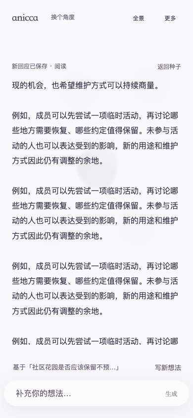
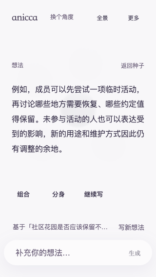
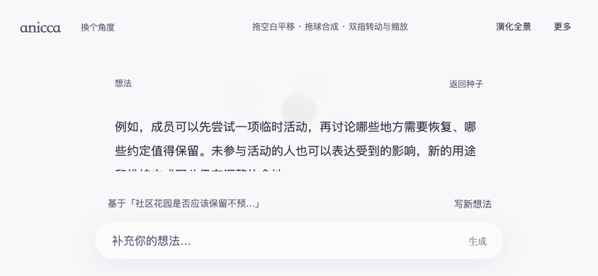

# App 体验复审项修复与发布验收

本轮落实独立评审的 2 项 P2、1 项 P3，沿用现有 main。主体继续无卡片，sketch1638178 的低饱和、软糯材质与手势未改；桌面默认 TSL 自动、移动默认原版，保留手动切换与自动回退。

## 已实现的行为

| 评审项 | 修复后 | 关键验证 |
| --- | --- | --- |
| P2-01 等待回应抢走原文 | 主动滚轮、触摸阅读或键盘滚读撤销自动跟随；回应保存后出现轻量文字入口，由用户选择阅读。无操作或程序恢复滚动仍自动打开回应；等待时的新草稿和目标不被改写。 | 无操作 / 程序滚动 / 用户滚读 / 继续写四类对照；明确打开已保存回应；内联追问完成后仍保持同一原文字符和视线位置。 |
| P2-02 改名写错工作区 | 改名会话绑定当前工作区 ID，创建或切换工作区后旧表单立即失效；提交再校验归属。 | A 未提交改名→已有 B / 新建 B，旧表单关闭；B 独立改名不会更改 A，返回 A 时显示其真实名称。 |
| P3-01 中段返回不明显 | 返回按钮处于正文滚动区外的透明文字工具行；标题和正文仍可滚动，不增加卡片或固定整块标题。 | 中段、底部、320×568、844×390、768×1024 均可见可点，命中高度≥44px；退出重开与刷新保持位置；极性仍先返回阅读。 |

阅读意图通过 `SeedInspector.onReadingIntent` 接入已有 attentionVersion。原始 `scroll` 只记位置，避免布局恢复或内联输入自动露出误判。内联问题完成、改为底部输入时，按原文字符锚点恢复视线；因此 scrollTop 可以变化，字符在屏幕上的位置应保持，而不是强求同一数字。

## 检查与候选版本

- [全仓检查](./verification/checks.txt)：lint 0 错误、26 个既有警告；生产与测试类型检查通过；93 个测试文件、698 项测试通过。首轮双 worker 的多项 10 秒超时保留在 [初始日志](./verification/targeted-initial-timeouts.txt)；单 worker 全量重跑通过，没有增大测试超时或跳过用例。
- [Linux 构建及打包](./verification/linux-build.txt)：Next.js 15.5.28 / Node 22 / Linux x64，`/Anicca` 生产构建完成。第一次打包因 root 所有的 release 目录权限失败，使用已有 sudo 权限重试打包成功；未把失败日志删除或伪称原构建任务退出成功。
- [源文件核对](./verification/source-verification.json)：270 个归档文件在构建机上与归档一致，其中 253 个应用/构建输入与最终工作区一致。新增 QA 脚本之后只修正了越过舞台 8 种子预算时的全景定位和证据记录；不属于发布包运行代码。
- [旧版反向验证](./verification/baseline-reading-continuity.json)：同一新增浏览器用例在 55a99f9 公网上正确捕获「继续读原文后被回应切走」，并非只验证新路径能够执行。
- [候选修复专项](./verification/candidate-reading-continuity.json)：桌面与移动均通过；[已有边界/Escape 回归](./verification/candidate-app-experience.json) 和 [完整受控链、拖拽及渲染回退](./verification/candidate-flow.json) 通过后才切换公网。

上一提交的 GitHub 视觉 CI 最终因所有软件渲染场景串行累计超过 30 分钟而失败。此次按既有过滤接口拆成五组、最多两组同时运行，保留全部视口与 9 个交互场景，保持原时限和每组证据；[覆盖核对](./verification/ci-coverage.json) 证明每个场景恰好分配一次。新 CI 的最终状态以本轮 push 后的运行结果为准，不把本机通过当作远端 CI 已通过。

## 发布对象

- 腾讯云当前 release：`/opt/anicca/releases/20261028-reading-continuity`。
- Build ID：`cbzA0qf4uovQnU4Bm1bsF`。
- [原子切换记录](./verification/rollout.json)：仅重启 `anicca.service`；active/running，重启数 0；候选服务已停止；上一 release 保留可回退。
- [公网协议核对](./verification/public-protocol.json)：`aitoshuu.me`、`tongye.me` 的 `/Anicca` 与 `/Anicca/dialogue` 均 200、匹配新 build、保留原域名和路径。没有修改 DNS、证书或反代配置。
- 版本对应关系通过发布目录的 `git-revision.txt`、远端 main 与应用源文件核对；最终提交号在交付回复中给出，避免文档自引用提交号。

## 公网验收证据

专项结果：[aitoshuu.me](./verification/aitoshuu.me-reading-continuity.json)、[tongye.me](./verification/tongye.me-reading-continuity.json)。每域名桌面 23 状态、移动 25 状态，共 96 状态，均无页面异常；20 次 inquiry 为明确持有/释放的受控回应，没有真实模型调用。滚读与键盘场景记录了完成前后的同一字符锚点，差异不超过 2px。

- [公网受控完整流程](./verification/public-controlled.json)：两个域名×桌面/移动，4 条完整链各 12 节点；鼠标/触摸拖拽合成、失败重试、取消迟到响应，以及原版/TSL WebGL2/TSL 自动的手动选择、刷新保留和模拟图形丢失回退均通过，无前缀静态资源失败。
- [公网真实接口流程](./verification/public-live.json)：4 条完整链、24 次接口请求全部 200，各保留 12 节点；长文第二处重复原句选择、追问草稿刷新、极性→正反→合成→合后继续正反→再刷新→继续极性全部通过。默认渲染器实测桌面 WebGPU、移动原版；受控测试中的移动 WebGPU 是用户手动选择对照，不是默认值迁移。
- [汇总](./verification/public-verification-summary.json) 与实际桌面/移动合成、继续展开截图已保存。已查看本轮实际公网截图，主体无卡片、低饱和软糯材质保持。

本轮使用隔离 Chromium 桌面与移动触摸视口，Browser plugin not available，沿用已有项目 Playwright；未清空真实用户工作区。未进行物理 iPhone/Android、系统软键盘、中文 IME 或 GPU 热机复测，不将模拟结果用于手机性能结论。

## 关键画面

