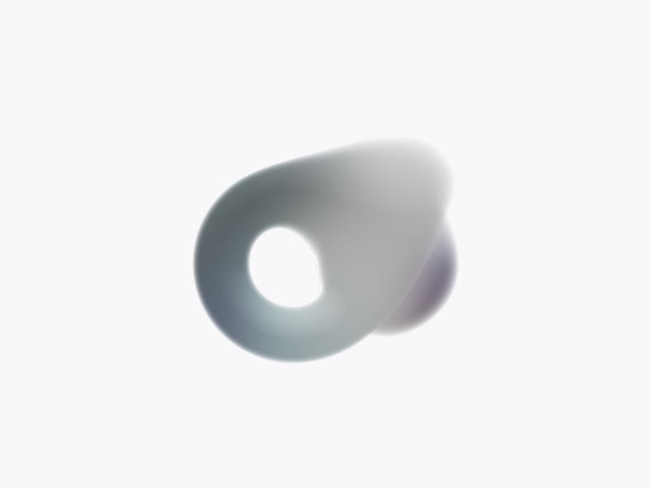

# 输入、导航与液体表面迭代

本轮按用户截图实施，不是独立 agent 评审。沿用无卡片、sketch1638178 的形体和低饱和软糯材质；未增加体积散射。主线程完成修改与验收。

| 截图中的问题 | 修改后 | 原因 |
| --- | --- | --- |
| 标题、提示、操作说明形成过多层级 | 正文 16、操作 14、辅助 13px；种子标题 20px，保留品牌字号 | 减少跳跃，正文仍能舒服阅读 |
| 输入胶囊与焦点圆框叠加，双操作时上下堆叠 | 透明直线输入，操作同行；焦点强化底线 | 统一输入语法，避免双框和断开的基线 |
| 导航控件分别定位，提示与正文抢位置 | 共用导航布局；阅读区与种子标签避让实际导航和提示高度 | 小屏、横屏和缩放后仍有明确边界 |
| 极性藏在阅读中的次级选择 | 舞台与阅读顶部共用正反、极性分裂、组合三项入口 | 基础操作同级，并继续使用原有维度选择 |
| 等待生成时只有文字提示 | 只在生成中的种子表面增加细噪波，完成、失败或取消后清除 | 等待反馈属于形体本身，不添加卡片 |
| 融合、分离、遮挡边缘出现白色断线 | 对各形体求法线后按原融合权重合成；掠射采样以实际球面交点建立区间，再收敛至表面 | 避免跨表面估算法线和未收敛交点造成亮点，保留软边及孔洞 |

极性入口只属于当前阅读会话；进入新结果时清除请求。延迟的鼠标单击期间收起旧种子的快捷操作，避免快速操作时组合错来源。关闭“换个角度”后焦点回到导航入口。

## 验收方式

生产构建在腾讯云 Linux 完成。候选和公网均使用独立 Chromium 工作区，桌面 1440×900、手机 390×844；边界包含 320、768、980/981px、844×390 横屏。Browser plugin not available，使用项目既有 Playwright 工作流做必要的视觉和交互验证，没有操作用户正在使用的工作区。本轮移动检查是触摸视口模拟，未重新连接真机。

- 全仓 lint、生产和测试类型、702 项测试通过；保留 26 条既有 lint warning。
- 等待、成功、失败、重试、取消、减少动态，以及两端手动选择原版 / TSL 自动 / TSL WebGL2；减少动态时噪波保持静止。
- 选句追问 → 极性两端 → 正反 → 拖拽合成 → 刷新 → 沿合继续展开；另查阅读位置、返回、Escape 层级和工作区改名归属。
- 三个渲染后端共 108 帧融合、第三球遮挡、分离检查。36 帧交界区域的亮点峰值由 25–82.5 降至 4–6（0–255 灰度、与八邻域中值之差）；回归脚本独立验证峰值小于 12。此指标用于复现碎亮点，不是手机 GPU 性能基准。
- 桌面默认 TSL 自动、移动默认原版；手动偏好刷新后保留，模拟图形上下文丢失能回退原版。

生产版本、两域名检查与实际接口结果见 [验收记录](verification/summary.json)。构建输入对应 [运行源码清单](verification/runtime-manifest.json)，候选版本对应 [发布来源](verification/release-source.json)。

## 视觉证据

融合交界修复前后：

双端等待表皮和直线输入截图保存在 verification 目录。详细方案见 [plan.md](plan.md)。
